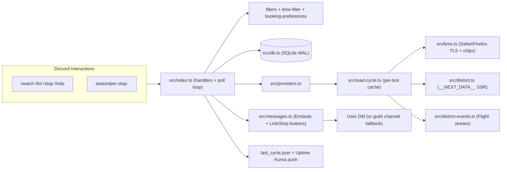

# SeatSniper — Claude Code Instructions

Multi-user Discord bot that watches public **BookMyShow** and **District** (movies & live events) pages and DMs users the moment tickets go on sale (or when new dates/cinemas unlock on a subscription). Strictly read-only — observes public pages and sends Discord alerts with public links; never logs into ticketing accounts, holds seats, mutates carts, or automates checkout.

Operator is Ishan (`IST`). Local working tree is `Projects/SeatSniper/`; production runs on Oracle VPS (`/home/ubuntu/seatsniper`). Never start a second poll loop against the same `DISCORD_TOKEN` or `seatsniper.db`.

## Stack & Pinned Versions

- **Runtime:** Bun `1.4.2` (**pinned on Linux** — avoid Bun `1.4.3`/`1.4.4` due to `oven-sh/bun#44982`, where native `koffi` FFI calls in `node-tls-client` followed by GC deadlock the Linux event loop)
- **Language:** TypeScript `7.0.2` (`strict: true`, `noUncheckedIndexedAccess: true`, `verbatimModuleSyntax: true`, `moduleResolution: "bundler"`)
- **Discord:** `discord.js` `14.28.1` (guild + user-install slash commands, interactive Stop buttons, Embeds + Link buttons, bounded caches)
- **Storage:** `bun:sqlite` in WAL mode (`PRAGMA busy_timeout = 5000`, `PRAGMA synchronous = NORMAL`, `.immediate()` transactions, zero ORM)
- **Providers:** `node-tls-client` `2.2.0` (Safari/Firefox TLS profiles for Cloudflare-gated BookMyShow) + native `fetch` with `AbortSignal.timeout` (District SSR `__NEXT_DATA__` & React Flight streams)
- **Quality Gate:** `@biomejs/biome` `2.6.x` + `tsc --noEmit` + `scripts/quality.ts` + `scripts/deadcode.ts` + `.gitleaks.toml`

## Commands

### Local Development

```bash
bun install
bun pm trust --all          # required: node-tls-client postinstall fetches native Go/koffi library
cp .env.example .env        # DISCORD_TOKEN, DISCORD_CLIENT_ID; optional DISCORD_GUILD_ID
bun run commands            # register slash commands (DISCORD_GUILD_ID = instant; global = ~1h)
bun run dev                 # watch mode (bun --watch src/index.ts)
bun run start               # production entry (bun src/index.ts)
```

Live DB defaults to `seatsniper.db` (`DB_PATH`). Tests must always point `DB_PATH` at an `os.tmpdir()` path — never touch `seatsniper.db` or leave `test-*.db*` artifacts in the repository root.

### Quality, Drift & Test Gate

```bash
bun run check               # full gate: typecheck + lint + quality + deadcode + bun test
bun run typecheck           # tsc --noEmit
bun run lint                # biome check src scripts integration.ts
bun run format              # biome format --write src scripts integration.ts
bun run quality             # AST cycle check + file-length ratchet + AGENTS.md sync + hygiene
bun run deadcode            # orphan-file + unused-dependency + broken-import check
bun run agents:sync         # regenerate <!-- AGENTS-MODULES --> table in AGENTS.md
bun test                    # offline unit + subprocess bot-flow suite
bun run integration.ts      # manual live BookMyShow probe (NEVER run in CI; geo-fenced)
```

*(Note: `scripts/deadcode.ts` replaces `knip` because `knip`'s `picomatch@4.0.7` dependency triggers fatal `CVE-2026-112366` in `@nebzdev/bun-security-scanner`.)*

### Production (Oracle VPS)

```bash
# systemd user unit (infra/systemd/seatsniper.service)
systemctl --user status seatsniper.service
systemctl --user restart seatsniper.service
tail -f /home/ubuntu/seatsniper/seatsniper.log

# or pm2 (install.sh default)
pm2 status seatsniper
pm2 restart seatsniper --update-env
pm2 logs seatsniper --lines 100
```

**How to judge real health:** Never trust `systemctl is-active`, `pm2 status = online`, or `docker compose ps = Up` alone (`discord.js` `client.isReady()` latches `true` across disconnects and a wedged event loop keeps its PID). Verify newest `[poll]` log timestamps, `last_cycle.json` freshness (`ts` within `2.5 × POLL_INTERVAL_SEC`), and `UPTIME_KUMA_PUSH_URL` heartbeats.

## Architecture



### 1. Command surface & creation-time validation (`src/index.ts`, `src/commands.ts`, `src/register.ts`)

- Unified multi-user command surface (`/watch`, `/list`, `/stop`, `/help`) registered with `ApplicationIntegrationType.{GuildInstall,UserInstall}` and `InteractionContextType.{Guild,BotDM,PrivateChannel}`.
- Interactive Stop buttons (`seatsniper:stop:<id>` and `seatsniper:stop:all`) verify `w.user_id === i.user.id` before mutating state and answer with `MessageFlags.Ephemeral`.
- `/watch` checks duplicate watches via `findWatch` before hitting the network, then queries the live provider immediately so invalid URLs, wrong cities, or blocked sessions fail up front rather than creating silent dead watches. Single-date watches with `format:` inspect BMS `formatSelector` child chips at creation time just like `subscribeToMovie` and `checkWatch`.

### 2. Provider router & per-cycle coalescing (`src/providers.ts`, `src/read-cycle.ts`, `src/stagger.ts`)

- `parseWatchUrl` dispatches `bookmyshow.com` URLs (both `/movies/<city>/<slug>/buytickets/ET…` and synopsis `/<city>/movies/<slug>/ET…`) to `src/bms.ts` and `district.in` / `m.district.in` URLs to `src/district.ts` (movies `MV…`) or `src/district-events.ts` (`EV:<slug>`).
- `ReadCycle` deduplicates concurrent and repeated reads within a single `poll()` tick (`provider|city|eventCode` for dates, `provider|city|eventCode|date` for showtimes). Rejected promises are evicted immediately so one transient network failure never poisons sibling watches in the same tick. `beginCycle()` clears the cache every tick.
- Watches inside a poll cycle sleep a uniform random pause in `[STAGGER_MS_MIN, STAGGER_MS_MAX)` (`src/stagger.ts`) to avoid automated burst signatures.

### 3. BookMyShow transport (`src/bms.ts`)

- Uses `node-tls-client` `2.2.0` restricted to Safari/Firefox TLS profiles (default `safari_ios_17_0` — empirically verified HTTP 200 on Oracle VPS). Sessions rotate cleanly every 24h (`SESSION_MAX_AGE_MS`) during `beginCycle()` to bound native Go cookie-jar growth while preserving `__cf_bm` mid-poll, and `closeBms()` calls both `session.close()` and `destroyTLS()`.
- `parseBookableDates` strips the coming-soon `additionalData.dateCode` page-default date whenever no `"showDateCode":"<date>"` exists in the payload, preventing phantom midnight alerts and poisoned `seen_dates` baselines.
- Availability is verified strictly by per-session `showDateCode === date` inside `window.__INITIAL_STATE__`, skipping sold-out sessions (`availStatus === "0"`), extracting optional tier pricing (`ticketCategories` for `budget:` checks), and following `formatSelector` child `ET…` chips (`chips: FormatChip[]`, including unioning child-chip bookable dates when `format:` is set so IMAX/PLF-first openings fire even before parent 2D dates open).

### 4. District movies & events (`src/district.ts`, `src/district-events.ts`, `src/booking-preferences.ts`)

- **Movies (`src/district.ts`):** Parses `__NEXT_DATA__` across all `languageFormatGroups` (`frmtid`) so formats attached to non-default language tabs are never missed, extracting sessions, screen formats, public seat-layout links, and per-category seat/price availability (`areas`) for optional `seats:` (`1–10`) and `budget:` (INR/seat before fees) filters.
- **Events (`src/district-events.ts`):** Parses Next.js Flight chunks strictly as data, ignoring RSVP/presale/locked/sold-out/`LOGIN`-gated states and alerting only when `event_state === "available"`, `user_action_state === "BOOK_TICKETS"`, and an unrestricted live `general_sale` is active.
- Both District clients cancel unread non-OK response bodies (`response.body?.cancel()`) to prevent `fetch` buffer retention and include `(Retry-After: <val>)` diagnostics on `429`/`503` blocks.

### 5. SQLite WAL database (`src/db.ts`)

| table | role |
|---|---|
| `watches` | Active one-shot date watches (`date = 'YYYYMMDD'`) and subscriptions (`date = ''`). `UNIQUE (user_id, provider, city, event_code, date)`. Cap `MAX_WATCHES_PER_USER = 5`. |
| `seen_dates` | Dates already announced for a subscription watch (`PK (watch_id, date)`, `ON DELETE CASCADE`). |
| `seen_venues` | Venue codes already announced for a subscription watch (`PK (watch_id, venue_code)`, `ON DELETE CASCADE`). |

- Configured with `journal_mode = WAL`, `foreign_keys = ON`, `busy_timeout = 5000`, and `synchronous = NORMAL`.
- Multi-row mutations (`recordSeenDates`, `recordSeenVenues`, schema migrations, and `addSubscription` watch + baseline seed) use `db.transaction(...).immediate()` so crashes mid-seed cannot leave unseeded phantom-alert subscriptions.
- **Delivery-before-commit:** One-shot watches are removed and `seen_*` ledgers updated **only after** `dm()` confirms Discord delivery.
- Shutdown runs `closeDb()` (`PRAGMA wal_checkpoint(TRUNCATE)` + `db.close(false)` — never `db.close(true)`, which throws `SQLITE_BUSY` on cached `db.query()` statements per `oven-sh/bun#29494`).

### 6. Gateway liveness, telemetry & graceful shutdown (`src/index.ts`, `src/messages.ts`)

- Gateway readiness checks `client.ws.status === Status.Ready` (never `client.isReady()`, which latches `true` on disconnect per `discord.js#11626`).
- `dm()` skips channel fallback when `ch.isDMBased?.()` is true to avoid guaranteed `50007`/`50001` API errors on user-install/BotDM watches.
- Every completed `poll()` writes atomic `last_cycle.json` liveness telemetry and pushes `UPTIME_KUMA_PUSH_URL` (`status=down` if gateway disconnected, cancelling unread response bodies).
- `SIGINT`/`SIGTERM` sets `shuttingDown = true`, clears `pollTimer`, awaits active poll drain (bounded), closes BMS TLS, bounds `client.destroy()` (`discord.js#11640`), and checkpoints/closes SQLite.

## Hard Constraints (Measured — Do Not Regress)

Full empirical write-up: [`docs/superpowers/specs/2026-07-27-bms-access-findings.md`](docs/superpowers/specs/2026-07-27-bms-access-findings.md).

1. **Safari/Firefox TLS only on BookMyShow.** Never use Chrome profiles in `node-tls-client` (Cloudflare challenges them) and never attach custom HTTP headers on top of the profile (fingerprint mismatch causes `403`s).
2. **Availability is an exact field check.** BookMyShow silently substitutes the nearest open date when the requested date is closed. URL, HTTP `200`, and `currentDateCode` all lie — only per-show `showDateCode` (and live `general_sale` + `BOOK_TICKETS` on District events) is trustworthy. Zero keyword heuristics.
3. **Errors are never empty results.** Network, `403`/`429` blocks, and unparseable responses must throw `BmsError`. Never swallow errors into `[]`; after 3 consecutive failures (`fail_count === 3`) SeatSniper alerts the user once so broken pollers cannot die silently.
4. **No headless browser / Camoufox poller.** Showtimes are SSR HTML/JSON served in ~50 ms over TLS (~15 MB native lib vs ~150+ MB headless browser). If Cloudflare hardens, rotate `BMS_TLS_PROFILE` across Safari/Firefox profiles first.
5. **Strictly observe-only.** Never reintroduce account login, OTP, seat holding, checkout commands, voice rings, or single-owner hardcoding.

## Ground Rules (Break These and the Work Is Rejected)

- **TDD first.** For any bug fix or behavior change, write a failing offline unit test in `src/*.test.ts` naming the failure mode before changing production code. Zero live network calls in `bun test` — use HTML/JSON fixtures under `src/fixtures/` or injected fetch/TLS stubs. Delete tests that only assert mock wiring or copy-pasted prose.
- **Quality gate is mandatory.** `bun run check` (`tsc --noEmit` + Biome lint + `scripts/quality.ts` + `scripts/deadcode.ts` + `bun test`) must pass with 0 errors. Production files stay `<= 400` lines (ratcheted legacy ceilings in `scripts/quality.ts` may only move **down**, never up). Adding or deleting `src/*.ts` requires `bun run agents:sync`.
- **Discord UX discipline.** Keep `EmbedBuilder` + `ActionRowBuilder<ButtonBuilder>` (never `MessageFlags.IsComponentsV2`, which `400`s when combined with `dm()`'s `content` fallback). Render showtimes and `last_ok_at` with Discord `<t:epoch:t>` / `<t:epoch:R>` syntax, never leak raw provider venue IDs, and keep user-facing copy in `src/messages.ts`.
- **Secrets & Git discipline.** `.env` and `*.db*` stay untracked; `.gitleaks.toml` runs in pre-commit and CI. Work on feature branches, keep PRs small and single-purpose, and never use `--no-verify` or `biome-ignore` without an explicit inline `why:` comment.

## Read Next

- [`AGENTS.md`](AGENTS.md) — Multi-agent roles, exclusive file lanes, `.env` reference, and auto-synced `src/*.ts` module table.
- [`docs/architecture.md`](docs/architecture.md) — Subsystem dataflow and design notes.
- [`docs/ops.md`](docs/ops.md) — Oracle VPS `systemd` / `pm2` / Docker operations, SQLite backups, and Cloudflare runbook.
- [`docs/releasing.md`](docs/releasing.md) — SemVer tag + multi-arch GHCR release pipeline.
