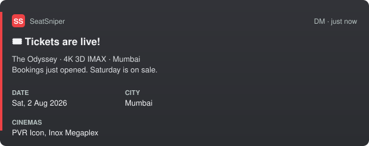

<p align="center">
  
</p>

<h1 align="center">SeatSniper</h1>

<p align="center">
  <b>Watch any BookMyShow or District page. Get a Discord DM the second tickets go on sale.</b><br>
  Self-host in one command. Bun + TypeScript + SQLite. No API keys, no credit card, no browser.
</p>

<p align="center">
  <a href="LICENSE"></a>
  <a href=".github/workflows/ci.yml"></a>
  <a href="https://github.com/Ishannaik/seatsniper/labels/good%20first%20issue"></a>
  
  
  
  
  <a href="https://github.com/Ishannaik/seatsniper/stargazers"></a>
</p>

<p align="center">
  
</p>

<p align="center">
  <code>curl -fsSL https://raw.githubusercontent.com/Ishannaik/seatsniper/main/install.sh | bash</code>
</p>

---

## TL;DR

You paste a **BookMyShow** or **District** link and a date (`2026-07-30`, `today`,
`tomorrow`, or `fri`). It polls the site, and the moment that date is bookable you get
one DM. Leave `date:` out (or say `date:any`) and it pings you every time a *new* date
unlocks or a *new* cinema/venue appears. Trim the noise with filters:
`format:IMAX,PXL,4DX` only pings for those screens, `theatre:PVR,INOX` only for those
cinemas or venues, `days:fri,sat` only on those weekdays, `after:18:00` / `before:23:00`
(`6pm` / `11pm`) for an IST time window, `budget:500` for max INR ticket price on
BookMyShow or District movies, and `seats:2` for public per-category seat counts on
District movies. (On BookMyShow subscriptions, `format:` and `days:` filter date and
showtime alerts while new-cinema alerts are theatre-filtered — see
[Commands](#commands).)

Works for movies and live events across BookMyShow and District in India.

It observes and notifies. It never logs into accounts, buys tickets, holds seats, or
fills carts.

## Table of contents

- [🎯 Features](#features)
- [🚀 Quick start](#quick-start)
- [🐳 Run with Docker](#run-with-docker)
- [📦 Manual setup](#manual-setup)
- [🎮 Commands](#commands)
- [🧠 How it works](#how-it-works)
- [⚙️ Configuration](#configuration)
- [🗺️ Project layout](#project-layout)
- [🧗 BookMyShow & District quirks](#bookmyshow-quirks)
- [🤝 Contributing](#contributing)

<a id="features"></a>

## 🎯 Features

| | |
| --- | --- |
| 📅 **Watch one date** | Paste a date (`2026-07-30`, `today`, `tomorrow`, `fri`, `next fri`) and get one DM the moment it opens. The watch then deletes itself. |
| 🎬 **Subscribe to a movie or event** | `date:any` (or no `date:`) = a DM every time a new date unlocks or a new cinema/venue appears across BookMyShow or District. |
| 🎥 **Format, theatre, day + time filters** | `format:IMAX,PXL,4DX` matches screen formats (ScreenX spelling is flexible, e.g. `SCREENX` or `SCREEN X`), `theatre:PVR,INOX` matches cinema or venue names and codes, `days:fri,sat` filters weekdays, and `after:18:00` / `before:23:00` (`6pm` / `11pm`) restricts IST start times. |
| 💺 **Price budget + District seat counts** | Optional `budget:500` filters BookMyShow and District movies by max listed INR price per seat before fees; `seats:2` (`1–10`) checks public per-category seat availability on District movies (seat adjacency is not checked). |
| 🛑 **One-tap Stop + autocomplete** | Live autocomplete on `/watch` (`date`, `format`, `days`, `after`, `before`) and `/stop id:`, plus interactive **Stop** and **Stop all** buttons directly on `/list` and watch embeds. |
| ✅ **Validates at creation** | Links (including mobile Share-sheet text and BMS movie synopsis URLs) are checked against the live provider before saving, so broken watches fail immediately. |
| ⚡ **One request per listing** | 50 watches on the same movie or event share one coalesced fetch per poll cycle. |
| 📱 **User-install commands** | Works in DMs and servers, installs straight to your account. |
| 💾 **SQLite, zero config** | No database server, no Docker required. One file. |

<a id="quick-start"></a>

## 🚀 Quick start

One command on Linux or macOS. It installs Bun, clones the repo, prompts for
your Discord credentials, registers the slash commands, and starts the bot under
pm2:

```bash
curl -fsSL https://raw.githubusercontent.com/Ishannaik/seatsniper/main/install.sh | bash
```

> `install.sh` supports Linux and macOS. On Windows, use the Manual setup or
> Docker instructions below. A datacenter VPS in India can work with Safari TLS
> to BookMyShow, while a residential home IP is optional, not required. See the
> [measured findings](docs/superpowers/specs/2026-07-27-bms-access-findings.md).

Non-interactive, for CI or a box with no terminal:

```bash
DISCORD_TOKEN=... DISCORD_CLIENT_ID=... bash <(curl -fsSL https://raw.githubusercontent.com/Ishannaik/seatsniper/main/install.sh)
```

Then:

1. Invite the bot with the URL the installer prints.
2. In Discord, run `/watch` and paste a BookMyShow or District link.
3. Wait. The DM arrives when tickets go live.

<a id="run-with-docker"></a>

## 🐳 Run with Docker

```bash
git clone https://github.com/Ishannaik/seatsniper.git && cd seatsniper
cp .env.example .env                  # fill in DISCORD_TOKEN and DISCORD_CLIENT_ID
docker compose run --rm seatsniper bun run commands   # register slash commands
docker compose up -d
```

Docker users do not need to run `bun pm trust --all` manually; the image's
dependency setup handles the required native dependency.

The database and cycle-liveness file live in a named `/data` volume owned by
non-root `USER bun`, so watches survive container restarts.

The container `HEALTHCHECK` inspects `last_cycle.json` (`LIVENESS_PATH`), verifying
both that a poll tick completed recently and that the Discord gateway is connected
(`gatewayReady`). For external alerting, configure `UPTIME_KUMA_PUSH_URL` (or run
`infra/kuma-heartbeat.sh` on the host) so a stalled poller pages you immediately.

<a id="manual-setup"></a>

## 📦 Manual setup

```bash
bun install               # installs via bun.sh (Bun >= 1.4.2; pin 1.4.2 on Linux)
cp .env.example .env      # DISCORD_TOKEN, DISCORD_CLIENT_ID
bun run commands          # register slash commands
bun run start             # or: bun run dev for watch mode
```

<details>
<summary><b>Behind systemd or pm2</b></summary>

A hardened `systemd --user` unit, `logrotate` config, and Uptime Kuma liveness
script ship in [`infra/`](infra/) (see [`docs/ops.md`](docs/ops.md)). For `pm2`:

```bash
pm2 start "$HOME/.bun/bin/bun" --name seatsniper --interpreter none --time -- run src/index.ts
pm2 save
```

Bun auto-loads `.env` from the working directory.
</details>

<a id="commands"></a>

## 🎮 Commands

| Command | What it does |
| --- | --- |
| `/watch link:<url> date:<when>` | Watch one date (`2026-07-30`, `today`, `tomorrow`, `fri`, `next fri`) on BookMyShow or District; DM once when it opens, then delete the watch |
| `/watch link:<url> date:any` | Subscribe (or omit `date:` when the link has no date). DM when a new date or cinema/venue appears |
| `/watch link:<url> format:IMAX,PXL,4DX theatre:PVR,INOX days:fri,sat after:18:00 before:23:00` | Optional filters on any watch (`date`, `format`, `days`, `after`, and `before` all support autocomplete). `after:`/`before:` are IST wall clock in 24-hour (`18:00`) or 12-hour (`6:00 PM`, `6pm`) format; `before:` is exclusive and the window cannot wrap past midnight (cinema `format:` does not apply to District events) |
| `/watch link:<movie-url> budget:500 seats:2` | Optional movie price & seat filters: `budget:` caps listed INR price per seat before fees on **BookMyShow and District** movies; `seats:` (`1–10`) requires that many seats available in one ticket category on **District** movies (adjacency is not checked) |
| `/list` | Show your active watches with direct links and interactive **Stop `#id`** / **Stop all** buttons |
| `/stop id:<n>` / `/stop all:true` | Stop one watch (with live autocomplete of your active watches) or stop all active watches |
| `/help` | Quick reference inside Discord |

Supported links (mobile Share-sheet text around the URL is stripped automatically):
- **BookMyShow:** `https://in.bookmyshow.com/<city>/movies/<movie>/ET…` or `https://in.bookmyshow.com/movies/<city>/<movie>/buytickets/ET…`
- **District movies:** `https://www.district.in/movies/<movie>-movie-tickets-in-<city>-MV…` (`m.district.in` also works)
- **District events:** `https://www.district.in/events/<event>-buy-tickets` (shortlinks like `bmsurl.co` / `link.district.in` and dining links are rejected with a clear hint)

> **What `format:` does and does not cover.** A subscription (`date:any`) can alert
> on two different things: a **new date** opening, and a **new cinema** starting to
> list the film. On BookMyShow, `format:` is enforced on the new-date half — the bot
> re-fetches showtimes (and matching format-selector child events) for each fresh date
> and drops the ones with no matching show. It is **not** enforced on BookMyShow's
> new-cinema half: fresh venues are detected by venue code from the probe response, so
> a new cinema listing the film in any format still produces a DM. `days:` behaves the
> same way there — it applies to dates, and a cinema is not a date. (District
> subscriptions already inspect per-date sessions, so fresh District cinemas also
> respect active show filters.)
>
> **`theatre:` is always enforced on new-cinema alerts.** A fresh venue already
> carries its name and code from the same response the diff is computed from, so
> `theatre:PVR` stays silent when an INOX starts listing the film. It matches
> case-insensitively as a substring of the cinema/venue name *or* its venue code, so
> `theatre:PVR` catches "PVR: Phoenix Palladium" and `theatre:IMOB` works if you'd
> rather paste a code.

Each user can hold up to 5 watches.

<a id="how-it-works"></a>

## 🧠 How it works

1. **Save.** `/watch` parses the BookMyShow or District link, checks for an existing
   duplicate watch immediately, and queries the live site once to confirm the movie or
   event exists. Bad links fail here, not days later.
2. **Poll.** Every `POLL_INTERVAL_SEC` (default 600 s) the bot checks each
   watch. Watches on the same listing share one coalesced request per cycle.
3. **Detect.** On BookMyShow, availability comes from `showDateCode` on each non-sold-out
   show (plus matching child format events when `format:` is set) — BookMyShow silently
   serves the nearest bookable date when the requested one is closed, so the URL, HTTP
   status, and page header all lie while the per-show field does not. On District,
   movies are verified from public `__NEXT_DATA__` SSR state across all language groups,
   and events are verified from Next.js Flight data only when live `general_sale` +
   `BOOK_TICKETS` inventory is open.
4. **Notify.** A dated watch DMs you once, then removes itself. A subscription
   compares today's dates and cinemas/venues against what it has seen before and DMs
   the difference, with direct public links and one-tap **Stop** controls.

Failure is never silence. A blocked or unparseable response throws and logs;
after 3 consecutive failures the bot tells you, so a dead poller cannot sit
quietly forever.

### Request coalescing

Within one poll cycle, `ReadCycle` (`src/read-cycle.ts`) keeps a promise map keyed
by provider, city, and event code (`src/providers.ts`), evicting rejected promises so
transient network blips do not poison later watches. `bookableDatesCached` and
`fetchShowtimesCached` reuse in-flight or completed fetches within the tick, so 50
watches on one film cost roughly one request per cycle. `beginCycle()` resets that
map at the start of every poll so an answer is never served across cycles.

Format and show-level filters on BookMyShow subscriptions require an extra showtimes
request per fresh date (coalesced across watches sharing that movie and date). Dated
watches check `bookableDatesCached` first and only fetch showtimes once the date is
open.

Coalescing reduces request volume on whatever egress you run. It is not a
substitute for suitable egress: BookMyShow checks the TLS fingerprint, and
its geographic restrictions can still block datacenter IPs outside India.

<a id="configuration"></a>

## ⚙️ Configuration

| Variable | Required | Default | Purpose |
| --- | --- | --- | --- |
| `DISCORD_TOKEN` | yes | | Bot token from the Discord developer portal |
| `DISCORD_CLIENT_ID` | yes | | Application ID from the same page |
| `DISCORD_GUILD_ID` | no | | Register commands in one guild instantly instead of waiting ~1 h for global |
| `POLL_INTERVAL_SEC` | no | `600` | Seconds between poll cycles (recommend at least 120-300 for personal use) |
| `STAGGER_MS_MIN` | no | `2000` | Shortest pause between two watches inside one cycle |
| `STAGGER_MS_MAX` | no | `5000` | Longest pause between two watches inside one cycle |
| `DB_PATH` | no | `seatsniper.db` | SQLite file location |
| `LIVENESS_PATH` | no | `<dir(DB_PATH)>/last_cycle.json` | Atomic JSON liveness snapshot written after each poll cycle for Docker `HEALTHCHECK` and host supervision |
| `UPTIME_KUMA_PUSH_URL` | no | | Uptime Kuma push URL; the bot pings it after each poll (and reports `down` if the Discord gateway disconnects) |
| `BMS_TLS_PROFILE` | no | `safari_ios_17_0` | `node-tls-client` profile for the BookMyShow session. Rotate only between **Safari/Firefox** profiles if Cloudflare starts blocking (see [BookMyShow & District quirks](#bookmyshow-quirks)). Chrome profiles are rejected, not merely discouraged. An unknown or unsupported name fails at startup. |

Keep `POLL_INTERVAL_SEC` at or above 120-300 seconds for personal use. Faster
polls do **not** require a residential IP; they increase request volume and
ban/rate-limit risk on any IP class. The default of 600 remains the safe
baseline.

`POLL_INTERVAL_SEC` spaces the cycles apart; the stagger spaces the watches
*inside* one cycle. Each watch is followed by a random pause drawn uniformly from
`[STAGGER_MS_MIN, STAGGER_MS_MAX)`. That is anti-burst insurance against looking
automated, so **setting both to `0` is allowed but discouraged** — it removes the only
thing spacing your requests out, at a rate-limit and bot-signature risk. Same point as
above: it is not a residential-IP question, since fingerprint and request shape matter
more than where the traffic comes from.

An unparseable or negative value is not fatal — the bot logs a `[config]` warning and
uses the default. A `STAGGER_MS_MAX` below `STAGGER_MS_MIN` is raised to the minimum,
giving a fixed delay, rather than being silently swapped.

<a id="project-layout"></a>

## 🗺️ Project layout

```
src/
  index.ts                bot, poll loop, slash & button handlers, liveness
  commands.ts             slash command schemas and live autocomplete
  register.ts             slash command registration
  db.ts                   SQLite WAL: watches, seen dates, seen venues
  providers.ts            BookMyShow + District router and cycle cache
  read-cycle.ts           per-poll promise coalescing
  movie-model.ts          shared Show, TicketCategory, Target, FormatChip types
  provider-error.ts       typed provider errors (BmsError)
  bms.ts                  BookMyShow client, TLS session, tiers, format chips
  district.ts             District movie client and SSR parser
  district-events.ts      District event client and Flight parser
  filters.ts              format, theatre, and weekday filters + suggestions
  time-filter.ts          natural IST dates and after/before time windows
  booking-preferences.ts  movie price budget and District seat-count filters
  messages.ts             Discord copy, embeds, link & Stop buttons
  stagger.ts              inter-watch stagger config (STAGGER_MS_MIN / STAGGER_MS_MAX)
scripts/
  quality.ts              architecture, file-length, cycle & hygiene gate
  deadcode.ts             unused file, export, and dependency check
  gen-agents-modules.ts   AGENTS.md module-table sync
infra/
  systemd/                hardened systemd --user service unit
  logrotate/              logrotate policy for VPS logs
  kuma-heartbeat.sh       host liveness push script reading last_cycle.json
assets/                   logo and README preview
docs/
  architecture.md         subsystem boundaries and dataflow
  ops.md                  self-hosting operations and VPS runbook
  releasing.md            release checklist: version bump, changelog, tag
  superpowers/            design specs and measured findings
```

See [`docs/architecture.md`](docs/architecture.md) for how the subsystems fit together
and [`docs/ops.md`](docs/ops.md) for production deployment and supervision.

<a id="bookmyshow-quirks"></a>

## 🧗 BookMyShow & District quirks

- **BookMyShow is geo-fenced and TLS-scored.** Datacenter IPs outside India can be
  blocked. A home server or India VPS is the safest host. The bot speaks Safari's TLS
  fingerprint via `node-tls-client`, which passes BookMyShow's Cloudflare checks, and
  resolves child `formatSelector` chips because formats like `ScreenX` and `IMAX`
  often live on separate `ET…` event codes.
- **District uses SSR + Flight state.** District movies expose sessions (including
  `extraSessions`), language groups, and category seat/price counts in `__NEXT_DATA__`;
  District events stream state via Next.js Flight chunks where RSVP/preregistration
  pages also report `available`, so SeatSniper waits for an active unrestricted
  `general_sale` with `BOOK_TICKETS`.
- **No heuristics.** Availability is an exact schema and field comparison, never a
  keyword guess. Measured BookMyShow findings live in
  [`docs/superpowers/specs/2026-07-27-bms-access-findings.md`](docs/superpowers/specs/2026-07-27-bms-access-findings.md).

## 🔧 Troubleshooting

| Symptom | Cause | Fix |
| --- | --- | --- |
| `bun install` / TLS lib missing | Bun blocks trusted deps | `bun pm trust --all` |
| HTTP 403 from BookMyShow | Chrome profile, bare curl, or wrong headers | Use a Safari/Firefox profile only; read the [measured findings](docs/superpowers/specs/2026-07-27-bms-access-findings.md) |
| "Need residential proxy?" | Prior-art myth | **No** for Safari TLS on a capable host; a measured Oracle datacenter works |
| Slash commands missing | Global vs guild registration | Set `DISCORD_GUILD_ID` for instant guild commands |
| DMs never arrive | User closed DMs | The bot falls back to the origin guild channel; open DMs with the bot |
| Integration tests fail in CI | Live BookMyShow from US runners | Keep `integration.ts` manual and not part of CI |

## ⚠️ Limitations & hosting

- **One shared hosted instance concentrates ban risk.** A single public bot is
  one IP ban away from going dark, and multi-tenant "forever free" bots are
  fragile.
- **SeatSniper is observe-only.** It never buys or holds tickets, by design.

When it will break: Cloudflare may harden the Safari handshake, an abused IP
can lose reputation even with a valid profile, and a BookMyShow or District
HTML/SSR reshape will surface loudly as a `BmsError` until the parser is
updated.

<a id="contributing"></a>

## 🤝 Contributing

Bug reports, feature ideas, and PRs are welcome. Start with
[CONTRIBUTING.md](CONTRIBUTING.md), which covers the setup and the hard
constraints the bot was built around, and run `bun run check` (`typecheck`,
`lint`, `quality`, `deadcode`, and `test`) before opening a PR. Report security
issues privately, see [SECURITY.md](SECURITY.md). New contributors can start at
the [good first issues](https://github.com/Ishannaik/seatsniper/labels/good%20first%20issue)
label.

## Community

Join the [Discord](https://discord.gg/KKvtRhQvRv) to chat with other contributors and get help.
Share feedback, swap ideas, or ask questions before opening a PR.

## 📄 License

MIT, see [LICENSE](LICENSE).

---

⭐ **If SeatSniper saved you a ticket, star the repo so the next person finds
it.**

<p align="center">
  <sub>Observes and notifies only. Never buys tickets. Made for the Friday 9 AM rush.</sub>
</p>
