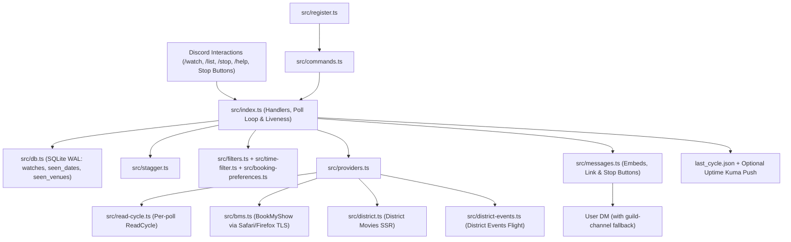

# SeatSniper Architecture

SeatSniper is a single-process, multi-user Discord bot built on **Bun**, **discord.js v14**, and **`bun:sqlite`**. It watches public **BookMyShow** and **District** (movies and events) pages and notifies users when tickets go on sale.

> **Core invariant:** SeatSniper is strictly read-only. It observes public ticketing pages and sends Discord notifications (with public link buttons). It never logs into user accounts, holds seats, mutates carts, or processes payments.

## Module map

All runtime modules live in a flat `src/` tree:

| Layer | Module | Responsibility |
| --- | --- | --- |
| **Entrypoint & commands** | `src/index.ts` | Discord gateway client, slash-command & button handlers (`/watch`, `/list`, `/stop`, `/help`, `seatsniper:stop:*`), poll loop, child-chip format checks, DM + channel-fallback delivery, `last_cycle.json` liveness telemetry, Uptime Kuma push |
| | `src/commands.ts` | Unified slash-command schemas and live autocomplete (`date`, `format`, `days`, `after`, `before`, and `/stop id`) |
| | `src/register.ts` | Guild or global Discord slash-command registration (`bun run commands`) |
| **Persistence** | `src/db.ts` | `bun:sqlite` WAL store (`watches`, `seen_dates`, `seen_venues`), atomic subscription seeding, schema migrations, per-user cap (`MAX_WATCHES_PER_USER = 5`) |
| **Provider router & cycle cache** | `src/providers.ts` | URL normalisation & dispatch (`parseWatchUrl`), unified `fetchShowtimes` / `fetchBookableDates` / `showtimesUrl`, and per-cycle cached wrappers |
| | `src/read-cycle.ts` | `ReadCycle` promise coalescer scoped to a single poll tick (evicting rejected promises so transient errors can retry) |
| | `src/movie-model.ts` | Shared `Show`, `TicketCategory`, `Target`, and `FormatChip` contracts plus `showsOnDate` |
| | `src/provider-error.ts` | Typed `BmsError` (`network`, `blocked`, `unparseable`, `bad_url`, `not_found`) |
| **Providers** | `src/bms.ts` | BookMyShow transport (`node-tls-client` Safari/Firefox TLS profiles with 24h idle session rotation), movie + `buytickets` URL parsing, `showDateCode` verification, `PROBE_DATE` discovery, tier pricing, poster extraction, and child format chips |
| | `src/district.ts` | District movie client: public `__NEXT_DATA__` SSR parsing across all language/format groups, regular + `extraSessions` shows, poster URLs, and per-category seat/price metadata |
| | `src/district-events.ts` | District event client: React Flight stream parsing for live `general_sale` + `BOOK_TICKETS` shows |
| **Filters & presentation** | `src/filters.ts` | Format (`IMAX`, `PXL`, `4DX`, `ScreenX`, …), theatre/venue, and weekday normalisation, matching, autocomplete, and summary formatting |
| | `src/time-filter.ts` | Natural IST date parsing (`today`, `tomorrow`, weekdays), 24h/12h (`18:00`, `6pm`) `after:`/`before:` window matching, and show epoch helpers |
| | `src/booking-preferences.ts` | Optional movie `budget` (BookMyShow + District INR/seat) and `seats` (`1–10`, District movies) category filters |
| | `src/messages.ts` | Discord embeds, poster thumbnails, relative timestamps, public booking link buttons, and interactive Stop buttons |
| | `src/stagger.ts` | Anti-burst inter-watch sleep bounds (`STAGGER_MS_MIN` / `STAGGER_MS_MAX`) |

Supporting tooling and operations files live alongside `src/`:
- **`scripts/`:** `quality.ts` (file-length, circular-import, `AGENTS.md` module-sync, and repo-hygiene gate), `deadcode.ts` (unused file/export/dependency check), and `gen-agents-modules.ts`.
- **`infra/`:** `systemd/seatsniper.service`, `logrotate/seatsniper`, and `kuma-heartbeat.sh` for Linux/VPS supervision.

## Data flow

## Key subsystems

### 1. Entrypoint, commands, and poll loop (`src/index.ts`, `src/commands.ts`, `src/register.ts`)

- **Unified command & button surface:** `src/commands.ts` defines `/watch`, `/list`, `/stop`, and `/help` for both guilds and user installs (`GuildInstall` + `UserInstall`, `Guild` + `BotDM` + `PrivateChannel`), with live autocomplete for `/watch` (`date`, `format`, `days`, `after`, `before`) and `/stop` (`id` populated from the caller's active watches, plus `all:true`). Embeds also carry interactive `seatsniper:stop:<id>` and `seatsniper:stop:all` buttons verified against `w.user_id`.
- **Pre-network duplicate check & creation-time validation:** `/watch` checks `findWatch` first (returning the existing `#id`, active filters, and a one-tap `Stop #<id>` button if already watched) before probing the live provider. Invalid event codes, mismatched cities, or unreachable pages fail immediately. On `today`, showtimes whose start epoch has already passed are excluded so a watch never fires for an earlier screening.
- **Poll loop, graceful shutdown & liveness:** Every `POLL_INTERVAL_SEC` (default 600s), `poll()` snapshots `allWatches()`, resets `beginCycle()`, retires past-date watches (`expireStale`), checks each watch with `[STAGGER_MS_MIN, STAGGER_MS_MAX)` jitter, atomically writes `{ ok, ts, sec, watches, coalesced, gatewayReady }` to `LIVENESS_PATH` (`last_cycle.json` next to `DB_PATH` by default), and pings `UPTIME_KUMA_PUSH_URL` (reporting `status=down` if the Discord gateway is disconnected). `SIGINT`/`SIGTERM` drains active work, closes the TLS session (`destroyTLS`), destroys the Discord client, checkpoints WAL, and closes SQLite cleanly.

### 2. Persistence (`src/db.ts`)

- Backed by `bun:sqlite` in WAL mode with `PRAGMA foreign_keys = ON`, `PRAGMA busy_timeout = 5000`, and `PRAGMA synchronous = NORMAL`.
- **`watches`** stores one-shot date watches (`date = 'YYYYMMDD'`) and movie/event subscriptions (`date = ''`), scoped uniquely by `(user_id, provider, city, event_code, date)` with filter columns (`format_filter`, `day_filter`, `after_filter`, `before_filter`, `theatre_filter`, `seat_count`, `seat_budget`).
- **`seen_dates`** and **`seen_venues`** track which dates and venue codes a subscription watch has already announced (`ON DELETE CASCADE`). Subscriptions are created and seeded atomically via `addSubscription` inside an `IMMEDIATE` transaction.
- **Delivery-before-commit:** One-shot watches are deleted and subscription ledgers (`seen_dates`, `seen_venues`) are updated **only after** `dm()` confirms delivery via DM or guild-channel fallback.

### 3. Provider router & cycle coalescing (`src/providers.ts`, `src/read-cycle.ts`, `src/movie-model.ts`, `src/provider-error.ts`)

- `parseWatchUrl` strips mobile Share-sheet promo text, rejects shortlinks with a clear hint, and routes `bookmyshow.com` URLs to `src/bms.ts` and `district.in` / `m.district.in` URLs to `src/district.ts` (including `/events/<slug>-buy-tickets` as `EV:<slug>` targets for `src/district-events.ts`).
- `ReadCycle` deduplicates concurrent or repeated reads by key (`provider|city|eventCode` for date discovery, `provider|city|eventCode|date` for showtimes) within a single poll tick while evicting rejected promises so transient errors do not poison later watches.
- All provider failures surface as `BmsError` rather than empty arrays. After 3 consecutive failures on a watch, SeatSniper sends a one-time `cannotRead` diagnostic alert.

### 4. Providers (`src/bms.ts`, `src/district.ts`, `src/district-events.ts`)

- **BookMyShow (`src/bms.ts`):** Uses `node-tls-client` restricted to Safari/Firefox TLS profiles (default `safari_ios_17_0`; Chrome profiles are rejected at startup). Accepts both movie synopsis URLs (`/{city}/movies/{slug}/ET…`) and `buytickets` URLs, verifies `window.__INITIAL_STATE__`, skips sold-out sessions (`availStatus === "0"`), compares per-session `showDateCode`, drops disabled coming-soon `pageDefault` dates that carry zero shows, extracts tier prices into `ticketCategories` (enabling `budget:` filters on BMS), probes `20991231` (`PROBE_DATE`) for open dates, and follows `formatSelector` child event chips (`chips: FormatChip[]` — unioning child-chip bookable dates when `format:` is set so PLF/IMAX drops that open before 2D are caught immediately).
- **District movies (`src/district.ts`):** Fetches public movie pages (`/movies/<slug>-movie-tickets-in-<city>-MV…`), validates `__NEXT_DATA__` SSR state across all `languageFormatGroups` (`frmtid`), merges `sessions` and `extraSessions`, and extracts screen formats, public seat-layout links, poster URLs, and per-category seat counts/totals/prices (`areas`).
- **District events (`src/district-events.ts`):** Fetches `/events/<slug>-buy-tickets` and parses Next.js React Flight chunks strictly as data, announcing shows only when `event_state === "available"`, `user_action_state === "BOOK_TICKETS"`, and an unrestricted live `general_sale` is active.

### 5. Filters & presentation (`src/filters.ts`, `src/time-filter.ts`, `src/booking-preferences.ts`, `src/messages.ts`)

- **Format, theatre, and day filters (`src/filters.ts`):** Normalises comma-separated lists with multi-value autocomplete (`Weekend`, `Weekdays`, formats). `matchesFormat` strips spaces/punctuation (`SCREENX` matches `3D SCREEN X`); `matchesTheatre` checks venue name and code; `matchesDay` evaluates weekdays in UTC.
- **Natural IST dates & time windows (`src/time-filter.ts`):** Resolves `today`, `tomorrow`, weekday names (`fri`, `next fri`), and ISO dates in IST, and parses 24-hour (`18:00`) and 12-hour (`6:00 PM`, `6pm`) `after:`/`before:` windows (`[after, before)`, non-wrapping).
- **Category preferences (`src/booking-preferences.ts`):** Validates `seat_budget` (max listed INR/seat before fees on BookMyShow and District movies) and `seat_count` (`1–10` available seats in a single category on District movies, without claiming adjacency).
- **Messages (`src/messages.ts`):** Builds mobile-friendly Discord embeds (`LIVE`, `ARMED`, `ALARM`, `RETIRED` colour semantics) with optional `https://` poster thumbnails, earliest-show relative countdowns, `_(filling fast)_` indicators, showtimes grouped by venue, public booking link buttons, and interactive `Stop` buttons.
