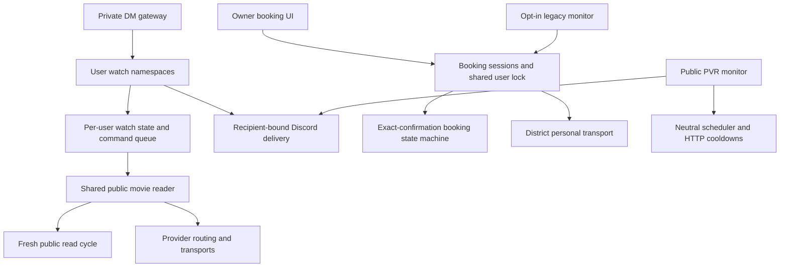

# SeatSniper change map

The two Discord entry points deliberately support different workflows:

| Change | Main modules |
| --- | --- |
| Classic subscriptions, events and SQLite watches | `index.ts`, `db.ts`, `messages.ts` |
| Private, per-user one-date movie watches | `user-dm-watches.ts`, `dm-watches.ts` |
| Slash registration/options and autocomplete | `commands.ts`, `dm-command.ts`, `register.ts` |
| Shared public reads, format children and native lifetime | `movie-reader.ts`, `read-cycle.ts`, `providers.ts` |
| Provider-specific HTML/API parsing | `bms.ts`, `district.ts`, `district-events.ts`, `pvr-monitor.ts` |
| Shared listing contracts, IST and filter rules | `movie-model.ts`, `time-filter.ts`, `filters.ts`, `watch-policy.ts` |
| District UI/modals | `district-booking-discord.ts` |
| Shared personal booking connections and per-user locking | `district-booking-application.ts` |
| Confirmation/hold/payment state machine | `district-booking.ts` |
| District transport, parsed responses and private connection state | `district-mcp.ts`, `district-response.ts`, `district-state.ts` |
| Discord delivery, alert recognition, reminders and voice | `discord-delivery.ts`, `alert-notice.ts`, `discord-reminders.ts`, `discord-voice-alerts.ts` |
| Generic scheduling and guest monitoring | `polling.ts`, `monitor-runtime.ts` |
| Existing opt-in movie-specific policy | `legacy-movie-policy.ts` |

All paths above are relative to `src/`. Modules stay in the shipped flat tree.

## Ownership and boundaries

Each DM user's JSON state, quota, filters, cancellation and destination remain
private. Only public listing reads are coalesced across users. One runtime owns
native TLS initialization/closure, not each private watch. Shared results are
copied before child formats are added and filters remain per watch. Each cycle
has fresh caches, including failures; later cycles can retry according to backoff.

The classic runtime retains its compatibility cache exports. Both provider caches
and DM reads use the same promise-cycle mechanism. Starting two gateway processes
with one bot token is still unsupported.

Booking background previews and Discord confirmations use one per-user lock and
cached connection owner. Guest monitoring never borrows personal booking tokens.
Confirmation IDs, exact arguments and explicit user consent remain required;
mutations and payments are never automatically retried. Moving the application
service did not change state files, button IDs or confirmation transitions.

Neutral models, JSON, HTTP cooldowns and scheduling do not import native TLS,
Discord UI, personal tokens or movie-specific configuration. Compatibility exports
from old module paths keep existing callers working. Legacy monitoring is still
opt-in; its policy is separate from generic private watches.

For command registration choose `BOT_RUNTIME=dm bun run commands` for the private
DM gateway, or keep the default classic registration for `src/index.ts`. Help,
accepted DM slash options and parser option names live in the DM command contract.
